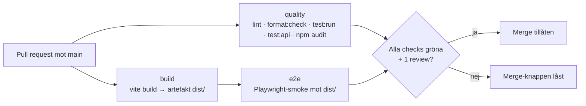

# Pipeline – Kraftly Mina sidor

*Dokumentation av CI-flödet, mergekrav och teamets uppmätta byggtider.*

## Flöde

`quality` och `build` kör parallellt. `e2e` väntar på `build` och testar den byggda artefakten – samma filer som senare deployas (M4).

## Vad som krävs för att merga

Branch protection på `main` (Settings → Rules → Rulesets):

- Pull request krävs, minst 1 godkännande.
- Required status checks: `quality`, `build`, `e2e`.
- Branchen måste vara uppdaterad mot `main` innan merge.
- Gäller även administratörer.

## Byggtid – uppmätta värden och cache

I en tidigare körning visade `actions/setup-node@v4` att npm-cachen återställdes (`Cache restored successfully`, cirka 54 MB). I en senare körning efter att cache-posterna tagits bort visade loggarna `npm cache is not found`.

### Jämförelse av installationstid och total körtid

| Steg | Utan cache – uppmätt | Med cache – uppmätt |
|---|---:|---:|
| `npm ci` i quality (Lint & unit tests) | 6 s | 7 s |
| `npm ci` i build | 8 s | 8 s |
| Hela CI-körningen | 2 min 27 s | 2 min 03 s |

Tiden 6 respektive 8 sekunder kommer från npm-utskriften `added ... packages ... in 6s/8s`. Jobbtiderna är separata från installationstiden. I den tidigare körningen var `Lint & unit tests` cirka 24 sekunder och `Build` cirka 20 sekunder.

I dessa enstaka mätningar syns ingen tydlig tidsvinst för `npm ci`: quality var 7 sekunder med cache och 6 sekunder utan cache, medan build var 8 sekunder i båda fallen. Hela körningen tog 2 min 03 s med cache och 2 min 27 s utan cache. Skillnaden mellan två enstaka körningar bevisar inte att cachen ensam orsakade tidsförändringen.

**Begränsning i jämförelsen:** Quality använde Node `22.23.3` (npm `10.9.9`) och Build använde Node `24.21.0` (npm `11.19.0`). Jämför därför cache och utan cache inom samma jobb och helst med samma Node-version, beroendefiler och arbetsflöde. Flera körningar behövs för en säkrare slutsats.

### Jobbtider från PR B och PR C

Tiderna nedan är tider för enskilda kontroller i GitHub Actions, inte tiden för `npm ci` eller hela pipelinen.

| Kontroll | PR B | PR C – tidigare körning | PR C – efter att cache-posterna togs bort |
|---|---:|---:|---:|
| AI-review (suggestion) | 15 s | 18 s | 18 s |
| CI / Bygg | 22 s | 20 s | 21 s |
| CI / E2E-smoke (Playwright) | 49 s | 43 s | 15 min |
| CI / Image GHCR | 35 s | 37 s | 36 s |
| CI / Lint & unit tests | 34 s | 33 s | 27 s |
| CI / Prestandabudget (Lighthouse) | cirka 1 min | cirka 1 min | 54 s |

För PR C lyckades alla sex aktiva kontroller i den senaste rapporterade körningen. Deploy-jobben till staging och production hoppades över.

**Observation om E2E:** E2E-smoke tog 15 minuter i den senaste rapporterade körningen, jämfört med 43 sekunder i en tidigare PR C-körning. Orsaken är inte fastställd. Kontrollera E2E-jobbets loggar för att se om tiden berodde på installation, väntan, omförsök eller själva Playwright-testet.

Att cache-posterna togs bort innebär inte automatiskt att samtliga jobb kördes utan cache. Kontrollera cache-statusen i respektive jobblogg innan en körning klassificeras som helt utan cache.

Cache-nyckeln baseras på `package-lock.json`. När lockfilen ändras kan en ny cache skapas. En cache-träff kan minska behovet av att ladda ner paket, men `npm ci` installerar fortfarande beroendena på nytt.

## Protokoll vid röd main

1. **Stoppa.** Ingen mergar något nytt förrän `main` är grön. Tech lead pingar i teamkanalen.
2. **Reproducera lokalt** med samma kommandon som pipelinen kör (de står i `ci.yml`).
3. **Laga framåt** om fixen är liten (under 30 minuter). Annars gör `git revert` av committen som gjorde `main` röd och felsök sedan i lugn och ro på en branch.
4. **Aldrig runt.** Inga avstängda checks och inga ”merga så fixar vi sen”.

## Beslut

- **E2E-verktyg:** Playwright – se `docs/decisions/e2e-verktyg.md`.
- **Parallellt eller i serie:** `quality` och `build` körs parallellt för snabbare feedback; `e2e` körs efter `build` för att testa artefakten.
- **Cypress-binären:** laddas inte ner i CI (`CYPRESS_INSTALL_BINARY=0`) – vi kör Playwright.

## npm audit (M6)

`quality` kör `npm audit --omit=dev --audit-level=high`. Hittar den något blir steget en **varning**, inte rött. Skälet är att en sårbarhet i ett beroende ska synas i varje körning, men en ny CVE i ett transitivt paket en fredag ska inte stoppa en hotfix.

Regeln: en varning som står kvar mer än en vecka blir ett ärende i backloggen. Om vi senare vill blockera bygget är det en ändring i `ci.yml`.
